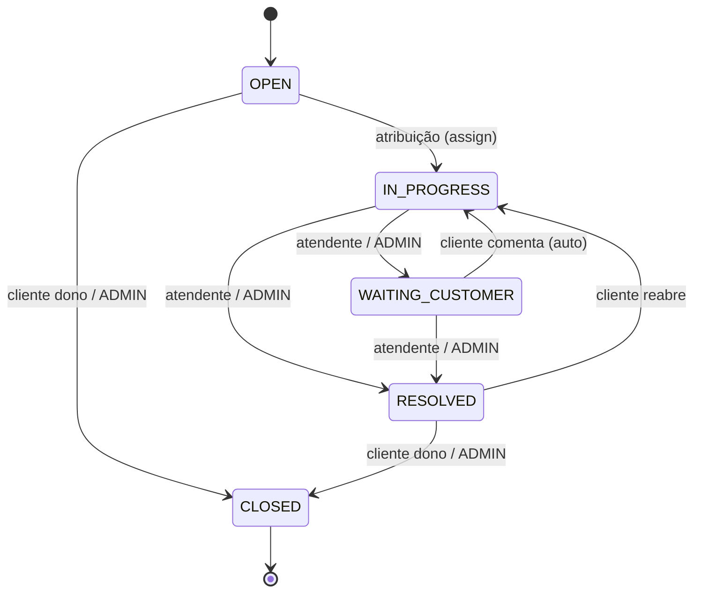

# TreinaDesk API — Referência para o frontend

> Fonte: Swagger da API em `http://localhost:3000/docs` (spec OpenAPI 3.0 em `http://localhost:3000/docs-json`), versão **1.0.0**.
> Este arquivo é um resumo das regras já definidas na API. Se houver divergência, **a API é a fonte da verdade**. Para atualizar, consulte a spec de novo (veja [Como atualizar](#como-atualizar-esta-referência)).

## Sumário

- [Convenções gerais](#convenções-gerais)
- [Autenticação e sessão](#autenticação-e-sessão)
- [Papéis e permissões](#papéis-e-permissões)
- [Endpoints](#endpoints)
- [Regras de tickets](#regras-de-tickets)
- [Regras de comentários](#regras-de-comentários)
- [Regras de categorias](#regras-de-categorias)
- [Modelos (schemas)](#modelos-schemas)
- [Validações de formulário](#validações-de-formulário)
- [Erros](#erros)
- [Checklist para telas](#checklist-para-telas)

---

## Convenções gerais

- **Base URL (dev):** `http://localhost:3000`. Configure por variável de ambiente; nunca fixe a URL no código.
- **Formato:** JSON em requisições e respostas.
- **Autorização:** rotas protegidas exigem o header `Authorization: Bearer <accessToken>`.
- **IDs:** sempre UUID. Um id malformado no path retorna **400**, não 404.
- **Datas:** strings ISO 8601 (`date-time`).
- **Paginação:** query `page` (mínimo 1, padrão 1) e `limit` (padrão 20). O máximo de `limit` muda conforme o endpoint (veja a tabela de endpoints). A resposta segue o formato:

```json
{ "data": [], "page": 1, "limit": 20, "total": 6 }
```

---

## Autenticação e sessão

| Token | Tipo | Validade padrão | Uso |
|---|---|---|---|
| `accessToken` | JWT | 15 min | Header `Authorization: Bearer ...` |
| `refreshToken` | Opaco | 7 dias | Corpo de `POST /auth/refresh` e `POST /auth/logout` |

### Fluxo

1. **Login:** `POST /auth/login` com `{ email, password }` → `{ accessToken, refreshToken }`. Retorna 401 quando as credenciais são inválidas.
2. **Usuário logado:** `GET /users/me` → `PublicUserResponse` (inclui o `role`, usado para montar a UI).
3. **Renovação:** quando receber **401** numa rota protegida, chame `POST /auth/refresh` com `{ refreshToken }` → novo par de tokens. Depois repita a requisição original.
4. **Logout:** `POST /auth/logout` (autenticado) com `{ refreshToken }` → **204**. Limpe os tokens locais.

### Regras críticas do refresh

- **O refresh token é rotacionado a cada uso.** O token enviado deixa de valer, e o frontend precisa guardar o novo.
- **Reutilizar um refresh token já usado revoga todas as sessões do usuário** e retorna 401. Isso inclui **duas requisições de refresh concorrentes com o mesmo token**.
  - ⇒ O frontend **DEVE** ter um refresh *single-flight*: só uma renovação em andamento por vez, com as demais requisições aguardando o resultado dela.
- Se `POST /auth/refresh` retornar 401 (token inexistente, expirado, revogado ou reutilizado), a sessão acabou: limpe os tokens e redirecione para o login.
- **Mudança de papel** (`PATCH /users/{id}/role`) revoga as sessões do usuário afetado. O novo papel só vale **no próximo login**.

---

## Papéis e permissões

Enum `Role`: `CUSTOMER` | `SUPPORT` | `ADMIN`.

| Papel | Quem é | Pode |
|---|---|---|
| `CUSTOMER` | Cliente (cadastro público) | Abrir tickets, ver e comentar nos próprios tickets, fechar ou reabrir os próprios |
| `SUPPORT` | Atendente | Ver a fila e os tickets atribuídos a ele, assumir tickets da fila, atender, criar notas internas |
| `ADMIN` | Administrador | Tudo: usuários, staff, papéis, categorias, (re)atribuição, ver todos os tickets |

- Um papel sem acesso à rota recebe **403**, com a mensagem indicando os papéis aceitos.
- Os cadastros de `SUPPORT` e `ADMIN` só são feitos por um ADMIN (`POST /users/staff`).
- O ADMIN **não pode alterar o próprio papel** (422).

---

## Endpoints

Legenda: 🌐 público · 🔒 qualquer autenticado · 🔒 `PAPEL` restrito

### App

| Método | Rota | Acesso | Descrição |
|---|---|---|---|
| GET | `/` | 🔒 | Mensagem de boas-vindas (string). Útil como health check autenticado |

### Auth

| Método | Rota | Acesso | Corpo | Resposta | Erros |
|---|---|---|---|---|---|
| POST | `/auth/login` | 🌐 | `LoginDto` | 200 `TokenPairResponse` | 400, 401 |
| POST | `/auth/refresh` | 🌐 | `RefreshTokenDto` | 200 `TokenPairResponse` | 400, 401 |
| POST | `/auth/logout` | 🔒 | `RefreshTokenDto` | 204 | 400, 401 |

### Users

| Método | Rota | Acesso | Corpo / Query | Resposta | Erros |
|---|---|---|---|---|---|
| POST | `/users` | 🌐 | `CreateUserDto` | 201 `PublicUserResponse` (sempre `CUSTOMER`) | 400, 409 e-mail já cadastrado |
| GET | `/users` | 🔒 `ADMIN` | `page`, `limit` (máx **100**) | 200 `PaginatedUsersResponse` | 400, 401, 403 |
| POST | `/users/staff` | 🔒 `ADMIN` | `CreateStaffDto` | 201 `PublicUserResponse` | 400, 401, 403, 409 |
| GET | `/users/me` | 🔒 | — | 200 `PublicUserResponse` | 401 |
| PATCH | `/users/{id}/role` | 🔒 `ADMIN` | `ChangeRoleDto` | 200 `PublicUserResponse` | 400, 401, 403, 404, 422 próprio papel |

### Categories

| Método | Rota | Acesso | Corpo | Resposta | Erros |
|---|---|---|---|---|---|
| GET | `/categories` | 🔒 | — | 200 `CategoryResponse[]` (ordenadas por nome) | 401 |
| POST | `/categories` | 🔒 `ADMIN` | `CreateCategoryDto` | 201 `CategoryResponse` | 400, 401, 403, 409 nome duplicado |
| PATCH | `/categories/{id}` | 🔒 `ADMIN` | `UpdateCategoryDto` | 200 `CategoryResponse` | 400, 401, 403, 404, 409 |

### Tickets

| Método | Rota | Acesso | Corpo / Query | Resposta | Erros |
|---|---|---|---|---|---|
| POST | `/tickets` | 🔒 `CUSTOMER` | `CreateTicketDto` | 201 `TicketResponse` | 400, 401, 403, 422 categoria inexistente ou inativa |
| GET | `/tickets` | 🔒 | `page`, `limit` (máx **50**), `status?`, `priority?` | 200 `PaginatedTicketsResponse` | 400, 401 |
| GET | `/tickets/{id}` | 🔒 | — | 200 `TicketResponse` | 400, 401, 404 |
| PATCH | `/tickets/{id}/assign` | 🔒 `SUPPORT`, `ADMIN` | `AssignTicketDto` | 200 `TicketResponse` | 400, 401, 403, 404, 409, 422 |
| PATCH | `/tickets/{id}/status` | 🔒 | `UpdateStatusDto` | 200 `TicketResponse` | 400, 401, 404, 409, 422 |

### Comments

| Método | Rota | Acesso | Corpo / Query | Resposta | Erros |
|---|---|---|---|---|---|
| POST | `/tickets/{ticketId}/comments` | 🔒 | `CreateCommentDto` | 201 `CommentResponse` | 400, 401, 403, 404, 409, 422 |
| GET | `/tickets/{ticketId}/comments` | 🔒 | `page`, `limit` (máx **100**) | 200 `PaginatedCommentsResponse` | 400, 401, 404 |

---

## Regras de tickets

### Enums

- `TicketStatus`: `OPEN` | `IN_PROGRESS` | `WAITING_CUSTOMER` | `RESOLVED` | `CLOSED`
- `TicketPriority`: `LOW` | `MEDIUM` | `HIGH` | `URGENT`

### Criação

- Só o `CUSTOMER` abre tickets. O ticket nasce `OPEN`, **sem atendente** (`assignee: null`), e o cliente vem do token.
- A `categoryId` precisa ser de uma categoria **ativa**.

### Visibilidade (`GET /tickets`, `GET /tickets/{id}`)

| Papel | Vê |
|---|---|
| `CUSTOMER` | Só os próprios tickets |
| `SUPPORT` | A **fila** (`OPEN` sem atendente) + os tickets atribuídos a ele |
| `ADMIN` | Todos |

- A lista vem ordenada dos **mais recentes primeiro**. Os filtros opcionais são `status` e `priority`.
- Um ticket fora da visibilidade retorna **404**, exatamente como um ticket inexistente. Não tente diferenciar os dois casos na UI.

### Atribuição (`PATCH /tickets/{id}/assign`)

- **SUPPORT:** assume um ticket da fila **para si**. Não envia `assigneeId`; se enviar, recebe **400**.
- **ADMIN:** **precisa** enviar `assigneeId` (o usuário precisa ser `SUPPORT`). Pode reatribuir tickets `OPEN`, `IN_PROGRESS` ou `WAITING_CUSTOMER`.
- Um ticket `OPEN` atribuído passa automaticamente a `IN_PROGRESS`.
- **422:** o ticket já está atribuído a você, o status não permite atribuição ou o destinatário não é `SUPPORT`.
- **409:** conflito de concorrência (o ticket mudou em outra requisição). Recarregue o ticket e tente de novo.

### Transições de status (`PATCH /tickets/{id}/status`)

| De → Para | Quem pode |
|---|---|
| `OPEN` → `IN_PROGRESS` | **Ninguém por esta rota.** Acontece só pela atribuição |
| `OPEN` → `CLOSED` | Cliente dono ou ADMIN |
| `IN_PROGRESS` → `WAITING_CUSTOMER` | Atendente atribuído ou ADMIN |
| `IN_PROGRESS` → `RESOLVED` | Atendente atribuído ou ADMIN |
| `WAITING_CUSTOMER` → `RESOLVED` | Atendente atribuído ou ADMIN |
| `WAITING_CUSTOMER` → `IN_PROGRESS` | Automático: o **cliente dono comenta** no ticket |
| `RESOLVED` → `IN_PROGRESS` | Cliente dono (reabrir) |
| `RESOLVED` → `CLOSED` | Cliente dono ou ADMIN |
| `CLOSED` → qualquer | **Nenhuma.** `CLOSED` é final e preenche `closedAt` |



- Uma transição não permitida para o papel ou para o status atual retorna **422**. Um conflito de concorrência retorna **409**.
- **Na UI:** mostre só os botões de transição válidos para o papel e o status atual, usando a tabela acima. Mesmo assim, trate 422 e 409.

---

## Regras de comentários

- **Quem comenta:** o cliente dono, o atendente atribuído e qualquer ADMIN.
  - Um SUPPORT que **não está atribuído** ao ticket recebe **422**.
  - Um ticket `CLOSED` não aceita comentários (**422**).
- **Notas internas** (`isInternal: true`): só `SUPPORT` e `ADMIN` podem criar. Um `CUSTOMER` que enviar `isInternal: true` recebe **403**.
  - Notas internas **nunca** são devolvidas ao `CUSTOMER` e **não contam** no `total` da paginação para ele.
- Um comentário do **cliente dono** num ticket `WAITING_CUSTOMER` muda o status para `IN_PROGRESS` automaticamente. Atualize o ticket na UI depois de comentar. Se o status mudar no meio da retomada automática, a resposta é **409**.
- A lista vem **em ordem de criação** (mais antigo primeiro).
- O `body` tem os espaços das extremidades removidos.

---

## Regras de categorias

- `GET /categories`:
  - **ADMIN** recebe todas, **com** o campo `active`.
  - **CUSTOMER / SUPPORT** recebem **só as ativas**, **sem** o campo `active`.
- Não existe exclusão. **Desativar (`active: false`) substitui a exclusão.**
- `PATCH /categories/{id}` aceita `name` e/ou `active`, e pelo menos um dos dois é obrigatório (sem nenhum, retorna 400).
- O nome é único (409 se duplicado).

---

## Modelos (schemas)

```ts
type Role = 'CUSTOMER' | 'SUPPORT' | 'ADMIN';
type TicketStatus = 'OPEN' | 'IN_PROGRESS' | 'WAITING_CUSTOMER' | 'RESOLVED' | 'CLOSED';
type TicketPriority = 'LOW' | 'MEDIUM' | 'HIGH' | 'URGENT';

interface Paginated<T> {
  data: T[];
  page: number;
  limit: number;
  total: number;
}

interface ErrorResponse {
  statusCode: number;
  message: string | string[]; // array em erros de validação (400)
  error: string;              // ex.: "Unprocessable Entity"
}

// --- Auth ---
interface LoginDto { email: string; password: string }
interface RefreshTokenDto { refreshToken: string }
interface TokenPairResponse { accessToken: string; refreshToken: string }

// --- Users ---
interface CreateUserDto { name: string; email: string; password: string }
interface CreateStaffDto extends CreateUserDto { role: 'SUPPORT' | 'ADMIN' }
interface ChangeRoleDto { role: Role }
interface PublicUserResponse {
  id: string;
  name: string;
  email: string;
  role: Role;
  createdAt: string;
}
interface UserSummaryResponse { id: string; name: string; role: Role }

// --- Categories ---
interface CategoryResponse { id: string; name: string; active?: boolean } // active só para ADMIN
interface CategorySummaryResponse { id: string; name: string }
interface CreateCategoryDto { name: string }
interface UpdateCategoryDto { name?: string; active?: boolean }

// --- Tickets ---
interface CreateTicketDto {
  title: string;
  description: string;
  priority: TicketPriority;
  categoryId: string;
}
interface AssignTicketDto { assigneeId?: string } // ADMIN: obrigatório; SUPPORT: proibido
interface UpdateStatusDto { status: TicketStatus }
interface TicketResponse {
  id: string;
  title: string;
  description: string;
  status: TicketStatus;
  priority: TicketPriority;
  category: CategorySummaryResponse;
  customer: UserSummaryResponse;
  assignee: UserSummaryResponse | null; // null enquanto não atribuído
  createdAt: string;
  updatedAt: string;
  closedAt: string | null;              // preenchido ao ir para CLOSED
}

// --- Comments ---
interface CreateCommentDto { body: string; isInternal?: boolean } // default false
interface CommentResponse {
  id: string;
  body: string;
  isInternal: boolean;
  createdAt: string;
  author: UserSummaryResponse;
}
```

---

## Validações de formulário

Espelhe estas regras no client para dar feedback imediato. A API valida de novo e retorna 400.

| Campo | Regra |
|---|---|
| `name` (usuário) | 2–100 caracteres |
| `email` (cadastro e staff) | formato de e-mail, máx. 200. É normalizado (minúsculas, sem espaços nas extremidades) |
| `email` (login) | string obrigatória. A API **não** valida formato nem tamanho no `LoginDto`; o frontend valida o formato mesmo assim (decisão de produto: toda conta passou pela validação do cadastro) |
| `password` (cadastro) | 8–128 caracteres |
| `password` (login) | obrigatória, máx. 128 |
| `role` (staff) | `SUPPORT` ou `ADMIN` |
| `name` (categoria) | 2–60 caracteres |
| `title` (ticket) | 5–120 caracteres |
| `description` (ticket) | 10–5000 caracteres |
| `priority` (ticket) | `LOW`, `MEDIUM`, `HIGH` ou `URGENT` |
| `categoryId` (ticket) | UUID de uma categoria **ativa** |
| `body` (comentário) | 1–5000 caracteres (depois do trim) |
| `page` | ≥ 1 |
| `limit` | ≥ 1. Máximo de 100 (users, comments) ou 50 (tickets) |

---

## Erros

Todos os erros seguem `ErrorResponse`. Em erros de validação, `message` pode ser um **array** de strings.

Observado na API real (out/2026):

- Os 401 de token ausente/inválido vêm como `{ "message": "Unauthorized", "statusCode": 401 }`, **sem** o campo `error`. O login com credenciais erradas retorna `message: "Credenciais inválidas"`.
- As mensagens 400 são do class-validator, em inglês, no formato `<campo> <regra>` (ex.: `email must be an email`, `password should not be empty`, `name must be longer than or equal to 2 characters`). Nunca exiba esse texto: o frontend o converte em campo + regra (`lib/api/errors.ts`) e mostra a mensagem pt-BR do formulário.
- O `accessToken` é um JWT com a claim `exp` (validade de 15 min), usada pelo `proxy.ts` para a renovação preventiva.

| Status | Significado | Ação sugerida na UI |
|---|---|---|
| **400** | Corpo, id ou query inválido | Exibir as mensagens de validação no formulário |
| **401** | Sem token, token inválido ou expirado / credenciais inválidas | Tentar o refresh (single-flight). Se falhar, ir para o login |
| **403** | Papel sem acesso à rota / CUSTOMER enviando nota interna | Esconder a ação para o papel. Exibir "sem permissão" |
| **404** | Recurso inexistente **ou** fora da visibilidade | Tela de "não encontrado" |
| **409** | Conflito: e-mail ou nome duplicado / ticket alterado por outra requisição | Duplicado: erro no campo. Concorrência: recarregar o ticket e avisar o usuário |
| **422** | Regra de negócio violada (transição inválida, categoria inativa, próprio papel etc.) | Exibir `message` em toast ou alerta |

---

## Checklist para telas

- [ ] Montar a navegação e as ações a partir do `role` vindo de `GET /users/me`.
- [ ] Cliente HTTP com header Bearer e refresh **single-flight** em 401.
- [ ] Guardar o **novo** refresh token depois de cada renovação.
- [ ] Botões de status só para transições válidas (papel + status atual).
- [ ] Checkbox "nota interna" visível só para `SUPPORT` / `ADMIN`.
- [ ] Recarregar o ticket depois de comentar (possível mudança automática de status).
- [ ] Tratar 409 recarregando o recurso.
- [ ] Select de categoria no "Novo ticket" usando `GET /categories` (o CUSTOMER já recebe só as ativas).
- [ ] Paginação respeitando o `limit` máximo de cada endpoint.
- [ ] Status e prioridade sempre com texto + cor (veja `components/ui/references/design-system.md`).

---

## Como atualizar esta referência

Com a API rodando, a fonte é o Swagger:

- UI: `http://localhost:3000/docs`
- Spec JSON: `http://localhost:3000/docs-json`

```bash
curl -s http://localhost:3000/docs-json -o openapi.json
```

Compare as rotas, os schemas e as descrições com este arquivo e atualize as seções afetadas.
